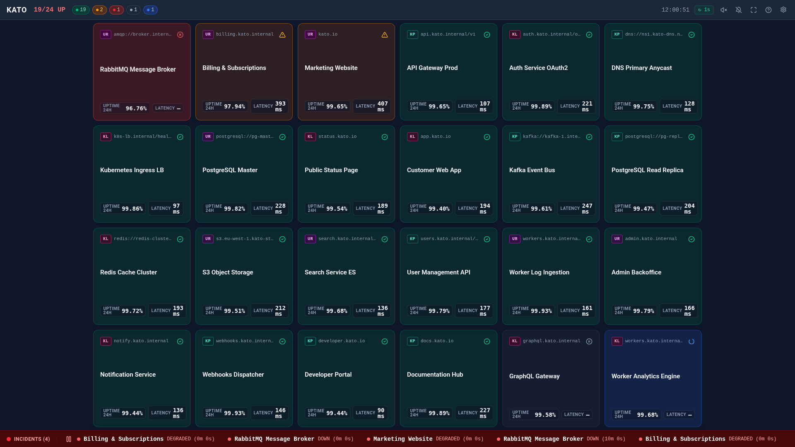
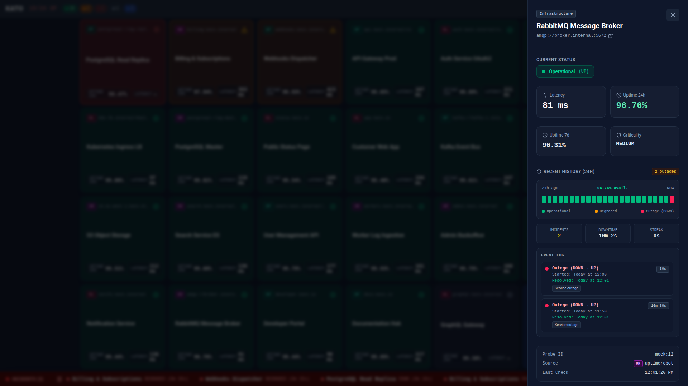
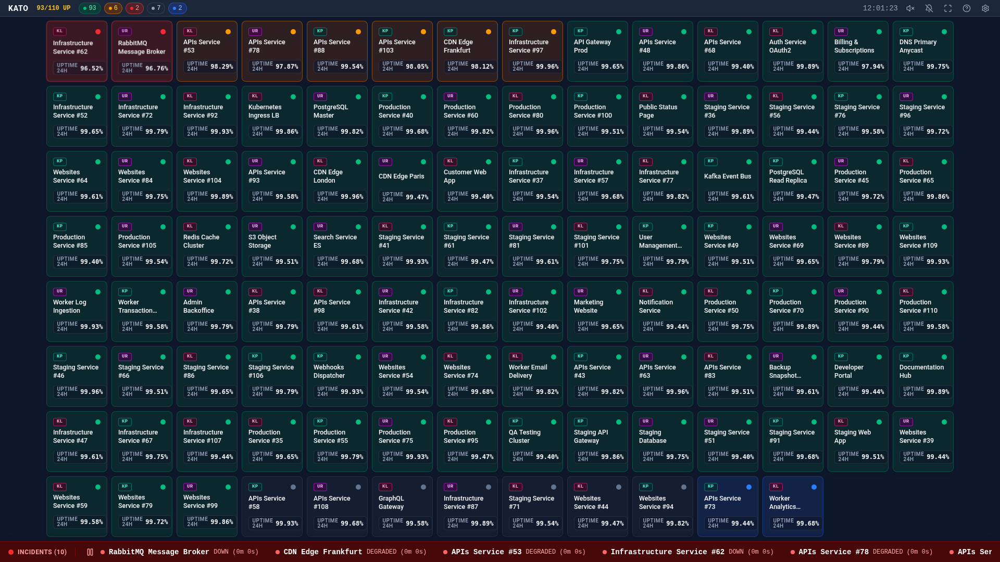

<div align="center">

# Kato — High-Density Monitoring Wallboard

**Display 1 to 200+ monitoring probes on a single screen with zero scrolling.**  
Aggregate multiple **Uptime Kuma** and **UptimeRobot** instances in real time on your TV, NOC wallboard, or desktop.

[](https://github.com/Kwaadpepper/kato-dashboard/actions/workflows/ci.yml)
[](https://github.com/Kwaadpepper/kato-dashboard/pkgs/container/kato-dashboard)
[-10b981)](https://kato.jeremydev.ovh/)
[](LICENSE)

[**📘 Documentation (English)**](https://kato.jeremydev.ovh/) · [**🇫🇷 Documentation (Français)**](https://kato.jeremydev.ovh/fr/) · [**🚀 Quick Start (30s)**](#-quick-start-30-seconds) · [**🐳 Docker Image**](https://github.com/Kwaadpepper/kato-dashboard/pkgs/container/kato-dashboard)

</div>

---

## 📸 Screenshots



| 24-Hour SLA & Outage Inspector | High-Density Zero-Scroll Matrix (110+ Probes) |
| :---: | :---: |
|  |  |

---

## ✨ Key Features

- **📐 Guaranteed Zero-Scroll Grid**: Automatically scales cards from detailed tiles down to compact status cells so 100% of your monitors fit on screen without vertical or horizontal scrollbars.
- **🔌 Multi-Source Aggregation & Color Badges**: Connect multiple **Uptime Kuma** servers (e.g., Production + LAN) and **UptimeRobot** accounts simultaneously on a single unified wallboard with color-coded source badges (`KP`, `KL`, `UR`).
- **⚡ Auto-Detection & Zero Database**: Pass `UPTIME_KUMA_URL` or `UPTIMEROBOT_API_KEY` and Kato automatically enables the right provider—no database required, API keys never leave the server.
- **🎯 Smart Outage Prioritization**: Monitors experiencing outages (`DOWN`) automatically jump to the top-left of the screen, followed by `DEGRADED` monitors.
- **📺 24/7 TV & NOC Mode (`?tv=1`)**: Automatic fullscreen, cursor auto-hide, OLED/AMOLED anti burn-in protection, Screen Wake Lock, and a continuous incident ticker.
- **🔔 Desktop Notifications, Audio & PWA**: Install as a standalone desktop or mobile app (PWA), receive native OS notifications (`N`), and enable built-in audio chimes (`M`) for outages and recoveries.
- **🕵️ Privacy / Screenshot Mode (`?anonymize=1`)**: One-click toggle in the Settings menu replaces sensitive monitor names, URLs, and groups with generic placeholders while keeping your real statuses, latencies, and uptime percentages.
- **🌍 Bilingual & Accessible**: Full **English** and **French** UI, 4 high-contrast themes (**Dark**, **Light**, **AMOLED**, **Auto**), and full keyboard navigation.

---

## 🚀 Quick Start (30 Seconds)

### 1. One-Liner `docker run`

```bash
# Instant Demo Mode (50 simulated multi-source monitors)
docker run -d --name kato -p 3000:3000 ghcr.io/kwaadpepper/kato-dashboard:latest

# Connect directly to Uptime Kuma (auto-detected)
docker run -d --name kato -p 3000:3000 \
  -e UPTIME_KUMA_URL=https://kuma.your-domain.com \
  -e UPTIME_KUMA_API_KEY=uk1_your_api_key \
  ghcr.io/kwaadpepper/kato-dashboard:latest

# Connect directly to UptimeRobot (auto-detected)
docker run -d --name kato -p 3000:3000 \
  -e UPTIMEROBOT_API_KEY=u123456-your_readonly_token \
  ghcr.io/kwaadpepper/kato-dashboard:latest
```

Open **`http://localhost:3000`** in your browser (or **`http://localhost:3000/?tv=1`** for TV wallboard mode).

---

### 2. `docker-compose.yml`

```yaml
services:
  kato:
    image: ghcr.io/kwaadpepper/kato-dashboard:latest
    container_name: kato-dashboard
    ports:
      - "3000:3000"
    environment:
      UPTIME_KUMA_URL: "https://kuma.your-domain.com"
      UPTIME_KUMA_API_KEY: "uk1_your_api_key"
      KATO_DEFAULT_LOCALE: "en" # 'en' or 'fr'
      KATO_DEFAULT_THEME: "dark" # 'dark', 'light', 'amoled', 'auto'
    restart: unless-stopped
```

```bash
docker compose up -d
```

---

### 3. Multi-Instance Setup (`KATO_ADAPTERS`)

Aggregate multiple Uptime Kuma servers and UptimeRobot accounts with distinct source badges (`KP`, `KL`, `RM`):

```dotenv
KATO_ADAPTERS=kuma_prod,kuma_lan,robot_main

ADAPTER_KUMA_PROD_URL=https://kuma.prod.acme.io
ADAPTER_KUMA_PROD_API_KEY=uk1_prod_token

ADAPTER_KUMA_LAN_URL=http://192.168.1.50:3001
ADAPTER_KUMA_LAN_API_KEY=uk1_lan_token

ADAPTER_ROBOT_MAIN_API_KEY=u987654-secret
```

👉 Read the [**Full Documentation (EN / FR)**](https://kato.jeremydev.ovh/) for all configuration options and keyboard shortcuts.

---

## 📄 License

Released under the [MIT License](LICENSE) © 2026 Jeremy ([Kwaadpepper](https://github.com/Kwaadpepper)).
