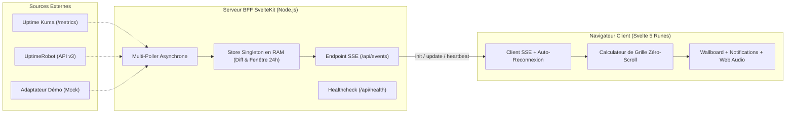

# Architecture & Moteur Zéro-Scroll

Kato repose sur une architecture **Backend-For-Frontend (BFF)** propulsée par **SvelteKit 2** et **Svelte 5 (Runes)** sur un serveur Node.js persistant (`@sveltejs/adapter-node`).

---

## 1. Flux de Données Temps Réel

### Pourquoi ce choix architectural ?
1. **Sécurité des clés API** : Les navigateurs clients ne contactent jamais Uptime Kuma ou UptimeRobot directement.
2. **Respect des quotas API** : Que vous ayez 1 ou 50 écrans TV ouverts sur Kato, le serveur BFF n'effectue qu'un seul appel périodique vers vos fournisseurs et mutualise le résultat en RAM.
3. **Bande passante minimale** : Le store en mémoire compare chaque collecte avec l'état précédent et n'envoie sur le flux SSE (`update`) que le **delta** strict (sondes modifiées ou supprimées, nouveaux incidents ou incidents résolus).

---

## 2. Algorithme de Grille Zéro-Scroll

Le calculateur géométrique (`src/lib/utils/grid-calculator.ts`) résout par convergence la taille optimale de cellule $S$, le nombre de colonnes $C$, le nombre de lignes $R$ et l'espacement $g$ pour que les $N$ sondes tiennent intégralement dans la surface $W_{\text{dispo}} \times H_{\text{dispo}}$ :

1. Estimation de la surface idéale par sonde : $A_{\text{idéale}} = (W_{\text{dispo}} \times H_{\text{dispo}}) / N$.
2. Dimension initiale : $S = \lfloor \sqrt{A_{\text{idéale}}} \rfloor$.
3. Boucle de convergence décrémentant $S$ jusqu'à vérifier :
   $$R \times (S + g) \le H_{\text{dispo}}$$
4. Attribution automatique du palier de densité (`large`, `medium`, `compact`, `micro`, `pixel`) selon la dimension finale de cellule.

---

## 3. Références Techniques Complètes

Pour les spécifications détaillées du protocole SSE, des modèles de données TypeScript et des contrastes WCAG AA, consultez les documents de référence :

- [System Architecture (EN)](/ARCHITECTURE)
- [Zero-Scroll Grid Algorithm (EN)](/GRID_ALGORITHM)
- [Data Model & SSE Protocol (EN)](/DATA_MODEL)
- [Colors, Themes & Accessibility (EN)](/COLORS_AND_THEME)
- [UX Components Specification (EN)](/UX_COMPONENTS)
